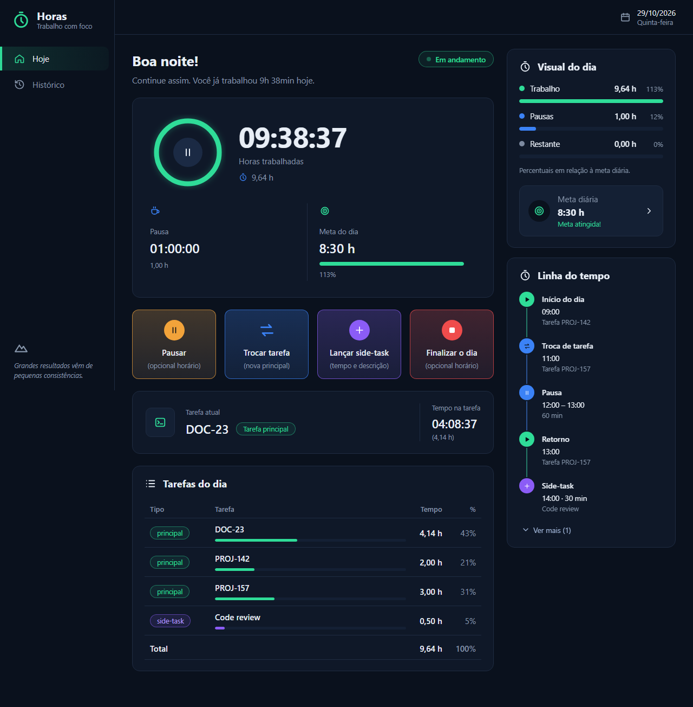

# time-tracker



Controle do tempo gasto em cada tarefa do trabalho. Registra o dia como uma
sequencia de eventos em um banco **SQLite** local e calcula as horas por tarefa,
descontando pausas e tempo de tarefas paralelas (side-tasks).

Da pra usar de tres formas, todas sobre o mesmo core e o mesmo banco:

- **CLI**: comandos no terminal (`python cli.py --start-day TASK-123`).
- **Web**: front React com tela "Hoje" em tempo real e "Historico", falando com a API HTTP.
- **Docker**: API e front em containers (ver [Docker](#docker)).

## Pacotes

Monorepo com quatro pacotes:

| Pacote | O que e |
|--------|---------|
| `packages/time-tracker-core` | Regras de negocio, calculo de horas e persistencia (SQLite). Sem argv, sem env, sem texto formatado. |
| `packages/time-tracker-cli`  | Interface de linha de comando: parsing de argumentos/horarios, formatacao e config. Depende do core. |
| `packages/time-tracker-api`  | API HTTP (FastAPI): contratos JSON e mapeamento de erros. Depende do core. |
| `packages/time-tracker-front`| Front React (Vite, tema escuro): tela "Hoje" (comandos, tempo real) e "Historico". Consome a API. |

## Requisitos

| Para usar | Precisa de |
|-----------|------------|
| CLI (e o core) | Python 3.9+. Apenas biblioteca padrao (`sqlite3`), sem servidor de banco. |
| API | Python 3.9+ com `fastapi` e `uvicorn` (instalados junto com o pacote da API). |
| Front (dev) | Node.js 20+ e npm, mais a API rodando. |
| Docker | Docker com Compose v2 (as imagens ja trazem Python 3.12 e Node 20). |

## Instalacao

A CLI nao precisa de instalacao: `python cli.py ...` na raiz roda direto do
codigo-fonte (da pra apontar um alias do shell para ele, ex.:
`alias tt='python /caminho/time-tracker/cli.py'`). Para instalar de verdade
(comando `time-tracker` no PATH do venv):

```bash
pip install -e packages/time-tracker-core -e packages/time-tracker-cli
```

Para a API, acrescente o pacote dela (`pip install -e packages/time-tracker-api`);
para o front, `npm install` em `packages/time-tracker-front` (ver
[Front](#front-react)).

Opcionalmente, um venv:

```bash
cd time-tracker
python -m venv .venv
# Windows
.venv\Scripts\activate
# Linux/macOS
# source .venv/bin/activate
```

## Configuracao

Todas as interfaces gravam no mesmo SQLite. O caminho vem da variavel de ambiente
`TIMETRACKER_DB` (na CLI tambem de um `.env`, se tiver `python-dotenv` instalado;
veja `.env.example`). Sem ela:

| Como roda | Banco padrao |
|-----------|--------------|
| `python cli.py` e `python api.py` | `time_tracker.db` na raiz do repo |
| comandos instalados (`time-tracker`, `time-tracker-api`) | `~/.time_tracker.db` |
| Docker (imagem da API) | `/data/time_tracker.db` |

A API tambem aceita `TIMETRACKER_API_HOST` (127.0.0.1) e `TIMETRACKER_API_PORT` (8000).

```bash
# Windows (PowerShell)
$env:TIMETRACKER_DB = "$HOME\time_tracker.db"
# Linux/macOS
export TIMETRACKER_DB="$HOME/.time_tracker.db"
```

## Uso da CLI

O schema e criado automaticamente na primeira execucao. Para forcar:

```bash
python cli.py --init
```

### Comandos

```bash
# Inicia o dia com a tarefa principal (horario = agora)
python cli.py --start-day TASK-123
# ou informando o horario de inicio (HH:MM ou 'YYYY-MM-DD HH:MM')
python cli.py --start-day TASK-123 09:00

# Pausa (sem anunciar retomada automatica)
python cli.py --pause
# ou com horario previsto de retomada
python cli.py --pause 13:00
# registrando uma pausa retroativa (ex: esqueceu de pausar antes do almoco)
python cli.py --pause --pause-at 12:39

# Retoma apos a pausa (ex: volta do almoco)
python cli.py --resume
# ou informando o horario retroativo em que voltou
python cli.py --resume --resume-at 14:09

# Lanca tempo numa tarefa paralela (code review, reuniao, analise de bug)
# TIME_SPENT aceita: 90, 1h30, 1h30m, 1:30, 45m
python cli.py --side-task REVIEW-1 45 "Code review do PR 42"

# Troca a tarefa principal no meio do dia, sem perder as horas da anterior
python cli.py --change-task TASK-456

# Finaliza o dia e imprime a tabela de horas
python cli.py --end-day

# Extras
python cli.py --report              # tabela parcial do dia atual (sem finalizar)
python cli.py --report 2026-09-11   # tabela de um dia especifico (YYYY-MM-DD)
python cli.py --status   # estado atual do dia
```

### Saida

As horas sao mostradas em **decimal com virgula** (ex.: 7h30m -> `7,5`):

```
Relatorio do dia 2026-09-11
  Inicio: 09:00
  Fim:    18:00

  Tipo       Tarefa    Horas
  ------------------------------
  principal  TASK-123   5,25
  principal  TASK-456   2,00
  side-task  REVIEW-1   0,75
  ------------------------------
  TOTAL                 8,00
  Pausas                1,50
```

A linha **Pausas** mostra o total de tempo pausado no dia (intervalos entre
`PAUSE` e `RESUME`). E apenas informativa: nao entra no `TOTAL` de horas
trabalhadas.

## Como o tempo e calculado

- O dia e uma linha do tempo de eventos: `START_DAY`, `PAUSE`, `RESUME`,
  `CHANGE_TASK`, `SIDE_TASK`, `END_DAY`.
- O cronometro corre do inicio ao fim do dia, descontando os intervalos entre
  `PAUSE` e `RESUME`.
- Cada intervalo ativo e creditado a tarefa principal vigente naquele intervalo
  (trocas com `--change-task` preservam as horas ja acumuladas).
- Uma `side-task` lanca minutos manualmente numa tarefa paralela; esse tempo e
  **debitado da tarefa principal vigente** no momento do lancamento e creditado
  a side-task, de forma que o total do dia continua fechando com o tempo corrido.

## Arquitetura

```
time-tracker/
  cli.py                        # atalho para rodar a CLI direto do codigo-fonte
  api.py                        # sobe a API direto do codigo-fonte
  pytest.ini
  docker/                       # api.Dockerfile, front.Dockerfile, nginx.conf
  packages/
    time-tracker-core/src/time_tracker_core/
      models.py                 # Event, DayState, DayReport, PauseResult (dados)
      calculator.py             # calculo puro de estado/horas
      service.py                # TimeTracker: casos de uso (ponto de entrada)
      repository.py             # EventRepository (porta de persistencia)
      sqlite_repository.py      # adapter SQLite (+ schema.sql)
      clock.py, errors.py
    time-tracker-cli/src/time_tracker_cli/
      main.py                   # argparse e despacho de comandos
      parsing.py                # 'HH:MM', '1h30', datas -> tipos de dominio
      formatting.py             # horas decimais com virgula, tabela do relatorio
      config.py                 # TIMETRACKER_DB / .env
    time-tracker-api/src/time_tracker_api/
      app.py                    # rotas FastAPI e mapeamento TrackerError -> 409
      schemas.py                # contratos JSON <-> tipos do core
      main.py, config.py        # uvicorn, host/porta, TIMETRACKER_DB
```

Regra de dependencia: interfaces -> core, nunca o contrario. O core recebe e
devolve tipos de dominio (`datetime`, `timedelta`, dataclasses); texto digitado
pelo usuario e texto formatado ficam na interface.

### Criando outra interface

Toda interface depende so de `time-tracker-core` e usa o `TimeTracker`
(como fazem o CLI e a API):

```python
from time_tracker_core import create_sqlite_tracker, TrackerError

tracker = create_sqlite_tracker("/caminho/time_tracker.db")
tracker.start_day("TASK-123")
report = tracker.build_report()   # DayReport com timedelta; serialize como quiser
```

Para outro armazenamento, implemente `EventRepository` (`add`, `list_for_day`)
e passe a `TimeTracker(repo)`.

## API HTTP

```bash
pip install -e packages/time-tracker-core -e packages/time-tracker-api   # traz fastapi e uvicorn
python api.py                 # http://127.0.0.1:8000 (docs em /docs)
```

Mesmo banco do CLI (`time_tracker.db` na raiz, ou `TIMETRACKER_DB`). Host/porta:
`TIMETRACKER_API_HOST` / `TIMETRACKER_API_PORT`. Sem autenticacao: mantenha em
localhost.

| Metodo e rota | Corpo (JSON) | Resposta |
|---------------|--------------|----------|
| `POST /days/start` | `{task_id, at?}` | 204 |
| `POST /days/pause` | `{auto_resume_at?, at?}` | 200 `{auto_resume_at, explicit}` |
| `POST /days/resume` | `{at?}` | 204 |
| `POST /days/change-task` | `{task_id, at?}` | 204 |
| `POST /days/side-task` | `{task_id, minutes, description?, at?}` | 204 |
| `POST /days/end` | `{at?}` | 200 relatorio |
| `GET /days/state`, `GET /days/{YYYY-MM-DD}/state` | | `{work_date, status, current_task}` |
| `GET /days/report`, `GET /days/{YYYY-MM-DD}/report` | | relatorio |
| `GET /events?start=&end=` | | lista de eventos (mais recentes primeiro) |
| `DELETE /events/{id}` | | 204 (404 se nao existe) |

`at` e ISO 8601 (sem fuso = horario local; padrao: agora). Relatorio:
`{work_date, started_at, ended_at, open_day, tasks:[{kind: main|side, task_id,
seconds, hours}], total_hours, paused_hours, ...}` com horas decimais numericas
(a virgula e so da CLI). Estado invalido para a operacao -> 409; corpo invalido
-> 422.

## Front (React)

```bash
python api.py                                # terminal 1: API em :8000
cd packages/time-tracker-front
npm install                                  # so na primeira vez
npm run dev                                  # terminal 2: http://localhost:5173
```

O Vite repassa `/api/*` para a API (sem CORS). Outra URL da API:
`VITE_API_TARGET=http://host:porta npm run dev`. Telas:

- **Hoje**: horas trabalhadas e pausa total em tempo real (relogio local, resincroniza
  com a API a cada 30 s e a cada comando), tarefa atual e formularios dos comandos
  (iniciar, pausar/retomar, trocar tarefa, side-task, finalizar). Mostra so os que fazem
  sentido para o estado do dia.
- **Historico** (menu lateral): eventos agrupados por dia, filtro por periodo e exclusao
  de registros (o tempo do dia e recalculado; excluir um `START_DAY` ou `RESUME` pode
  deixar o dia inconsistente).

## Docker

Em `docker/` ha um Dockerfile para a API e outro para o front. Ambos usam a raiz
do repo como contexto de build.

| Imagem | O que faz |
|--------|-----------|
| `docker/api.Dockerfile`   | Python 3.12 + core + API (FastAPI). Escuta na 8000 e grava o SQLite em `/data/time_tracker.db` (`TIMETRACKER_DB`). Fuso padrao `America/Sao_Paulo` (`TZ`), que define a virada do dia. |
| `docker/front.Dockerfile` | Build do React/Vite e nginx servindo o resultado; `docker/nginx.conf` repassa `/api/` para o servico `time-tracker-api:8000`. |

Exemplo de `docker-compose.yml` (ajuste o `context` para o caminho do repo):

```yaml
services:
  time-tracker-api:
    build:
      context: ./time-tracker
      dockerfile: docker/api.Dockerfile
    environment:
      TZ: America/Sao_Paulo
    volumes:
      - ./time-tracker:/data      # pasta, nao o arquivo (o SQLite precisa dos arquivos de journal)

  time-tracker-front:
    build:
      context: ./time-tracker
      dockerfile: docker/front.Dockerfile
    ports:
      - "3012:80"
    depends_on:
      - time-tracker-api
```

O nome do servico da API precisa ser `time-tracker-api`, pois o nginx o referencia.
Sem autenticacao: so o front e publicado; mantenha em localhost.

**Compartilhar o banco com a CLI:** ao montar a pasta do repo em `/data`, o
container usa o mesmo `time_tracker.db` da CLI (`python cli.py`), entao terminal e
web enxergam os mesmos dados. Evite gravar pela CLI e pela web ao mesmo tempo
(SQLite com escritas simultaneas). Se preferir bancos separados, monte outra pasta
ou um volume nomeado em `/data`.

## Testes

```bash
pip install pytest httpx   # httpx e exigido pelo TestClient da API
python -m pytest
```

O `pytest.ini` aponta para o codigo-fonte dos pacotes, entao nao precisa instalar
nada alem de `fastapi`, `uvicorn`, `pytest` e `httpx`. Os testes usam um SQLite
temporario e relogio fixo.

## Licenca

MIT — veja [LICENSE](LICENSE).
